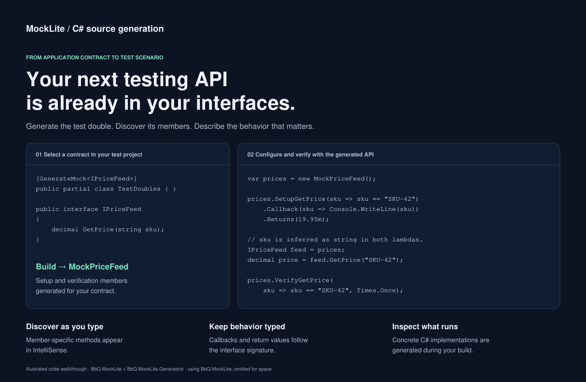
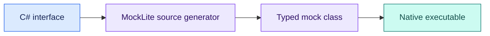

# MockLite

## Your interfaces. Your testing API. Generated.

**Turn application contracts into test doubles with setup, callbacks and verification tailored to every member.** MockLite's C# source generator creates concrete mock classes during your build, so you can discover the testing API in IntelliSense, write typed behavior and inspect the generated implementation.

Less time maintaining handwritten fakes. More time describing how your application should behave.

[Try your first generated mock](#try-it-in-a-test-project) · [Explore the generated API](https://github.com/JeanMarcMbouma/MockLite/wiki/Source-Generators) · [Upgrade to 2.x](https://github.com/JeanMarcMbouma/MockLite/wiki/Migrating-to-2.x)



*Illustrated code walkthrough. The same API calls appear below as selectable text.*

## A testing workflow built around your contracts

| What you need to do | What the generator gives you |
|---|---|
| Find the right setup without memorizing a framework | Member-specific methods such as `SetupGetPrice` and `GetPriceReturns`, discoverable in IntelliSense |
| React to a call using real argument types | Callbacks and return factories whose parameters are inferred from the interface signature |
| Check the interaction that matters | Methods such as `VerifyGetPrice`, with typed predicates and `Times` counts |
| Keep test doubles aligned as contracts evolve | Concrete implementations regenerated at build time; references to changed generated members receive normal C# compiler feedback |
| Understand what runs in your test | Generated C# you can inspect, with no `DispatchProxy` on the generated invocation path |

The package pairs source generation with Roslyn diagnostics and code fixes for recognized setup mistakes. See [which diagnostics are implemented](https://github.com/JeanMarcMbouma/MockLite/wiki/Analyzers).

## Native AOT

Use the same generated mock classes in Native AOT builds. Construct
`new MockPriceFeed()` for typed setup and verification, then pass it to your
code as `IPriceFeed`.



[Publish and run a Native AOT example with MockLite 2.0.2](./docs/wiki/Native-AOT.md).

## Try it in a test project

Add both packages to the project that will compile your generated mocks:

```bash
dotnet add package BbQ.MockLite
dotnet add package BbQ.MockLite.Generators
```

The core package contains the shared runtime; the generator package supplies source generation, analyzers and code fixes. The repository builds with .NET 8 and .NET 10 SDKs; the generator targets .NET 8. Use a current SDK and C# language version supported by your project.

### 1. Select a contract

Keep the generation declaration in your test project. This also works for interfaces from referenced assemblies, so you can leave application contracts untouched:

```csharp
using BbQ.MockLite;

[GenerateMock<IPriceFeed>]
public partial class TestDoubles { }

// Example contract; normally imported from your application.
public interface IPriceFeed
{
    decimal GetPrice(string sku);
}
```

Build the project. MockLite generates `MockPriceFeed` in the interface's namespace. For an interface you want to annotate directly, `[GenerateMock]` on that interface is also supported.

### 2. Describe the scenario

```csharp
var prices = new MockPriceFeed();

prices.SetupGetPrice(sku => sku == "SKU-42")
    .Callback(sku => Console.WriteLine($"Looked up {sku}"))
    .Returns(19.95m);
```

`sku` is a `string`, inferred from the contract. The predicate filters both the callback and the configured return behavior. The setup API is generated for this method, so incompatible callback signatures and return types receive C# compiler feedback.

### 3. Exercise the behavior and verify it

```csharp
IPriceFeed feed = prices; // Pass this interface to your system under test.
decimal price = feed.GetPrice("SKU-42"); // 19.95m

prices.VerifyGetPrice(sku => sku == "SKU-42", Times.Once);
```

In a real test, call the service that consumes `IPriceFeed`, assert its result with your test framework, then verify the interaction. Construct `MockPriceFeed` directly to access its generated setup and verification members; `Mock.Of<IPriceFeed>()` returns the interface type.

## Start with one dependency

Try a generated mock in one new test or replace one handwritten fake. Existing tests can continue using their current tools while you evaluate the workflow.

| Scenario | Starting point |
|---|---|
| Configure a generated mock with member-specific helpers | `new MockPriceFeed()` |
| Generate a mock for an interface you cannot annotate | `[GenerateMock<IExternalService>]` on a class in your test project |
| Use an expression-based runtime mock without generation | `Mock.Create<IPriceFeed>()`, then pass its `.Object` to your service |

Generated mocks support methods, properties, typed matching, callbacks, async return shapes and invocation recording. There are boundaries: generic interface methods do not receive generated setup/returns helpers; overloaded methods use signature-qualified helper names. Check the [API reference](https://github.com/JeanMarcMbouma/MockLite/wiki/Source-Generators) for naming and supported shapes before choosing a contract.

For measured comparisons and reproducible commands, see the [wiki benchmarks](https://github.com/JeanMarcMbouma/MockLite/wiki/Benchmarks) and [benchmark project](./benchmarks/MockLite.Benchmarks).

## Go further in the wiki

- [Generated and runtime API reference](https://github.com/JeanMarcMbouma/MockLite/wiki/API-Reference) — signatures, matching and verification.
- [Getting started](https://github.com/JeanMarcMbouma/MockLite/wiki/Getting-Started) and [source generators](https://github.com/JeanMarcMbouma/MockLite/wiki/Source-Generators).
- [Benchmarks](https://github.com/JeanMarcMbouma/MockLite/wiki/Benchmarks) — commands and historical measurements.
- [Sample application](./src/MockLite.Sample/Program.cs) — more complete scenarios.
- [Callback guide](https://github.com/JeanMarcMbouma/MockLite/wiki/Callbacks) and [quick reference](https://github.com/JeanMarcMbouma/MockLite/wiki/Callback-Quick-Reference).
- [Analyzer status](https://github.com/JeanMarcMbouma/MockLite/wiki/Analyzers) — active and reserved diagnostics.
- [2.x migration guide](https://github.com/JeanMarcMbouma/MockLite/wiki/Migrating-to-2.x) — interaction changes for existing users.

**Upgrading from 1.x?** In 2.x, runtime `Verify(expression, times)` honors expression arguments, setup callbacks inherit matching, and the newest matching setup wins. Use `VerifyAnyArguments` for an intentional method-wide count.

Questions or an interface shape that needs support? [Open an issue](https://github.com/JeanMarcMbouma/MockLite/issues).
