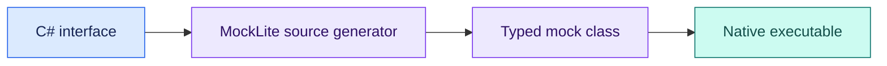

# Native AOT with MockLite

Construct your generated mock directly in a Native AOT project. MockLite generates the concrete class at build time, so your code can use typed setup and verification without creating a runtime proxy.



## Try it with 2.0.2

Create a console project and add the two packages. The console app lets you publish and execute the example as a native binary.

```sh
dotnet new console -n MockLiteAotExample -f net8.0
cd MockLiteAotExample
dotnet add package BbQ.MockLite --version 2.0.2
dotnet add package BbQ.MockLite.Generators --version 2.0.2
```

Replace `Program.cs` with this example.

```csharp
using BbQ.MockLite;

var prices = new MockPriceFeed();
prices.SetupGetPrice(sku => sku == "SKU-42").Returns(19.95m);

IPriceFeed feed = prices;
if (feed.GetPrice("SKU-42") != 19.95m)
    throw new InvalidOperationException("Unexpected price.");

prices.VerifyGetPrice(sku => sku == "SKU-42", Times.Once);
Console.WriteLine("Generated mock passed.");

[GenerateMock<IPriceFeed>]
public partial class TestDoubles { }

public interface IPriceFeed
{
    decimal GetPrice(string sku);
}
```

Install the [.NET Native AOT prerequisites](https://learn.microsoft.com/dotnet/core/deploying/native-aot/) for your platform. On Linux x64, publish and run the example with these commands.

```sh
dotnet publish -c Release -r linux-x64 -p:PublishAot=true -warnaserror -o native
./native/MockLiteAotExample
```

## Choose the entry point

| Entry point | Behavior in a Native AOT project |
| --- | --- |
| `new MockPriceFeed()` | Use this for generated setup and verification. The concrete class implements `IPriceFeed` directly. |
| `Mock.Of<IPriceFeed>()` | Can fall back to runtime discovery and proxy creation. Use the concrete generated class for Native AOT. |
| `Mock.Create<IPriceFeed>()` | Creates a runtime proxy that requires dynamic code generation. |

Generated mocks can use reflection metadata for invocation records. The example exercises a generated setup, a call through the interface, and argument-aware verification. Publish and run your own test application with AOT warnings enabled to validate its full set of contracts and dependencies.
